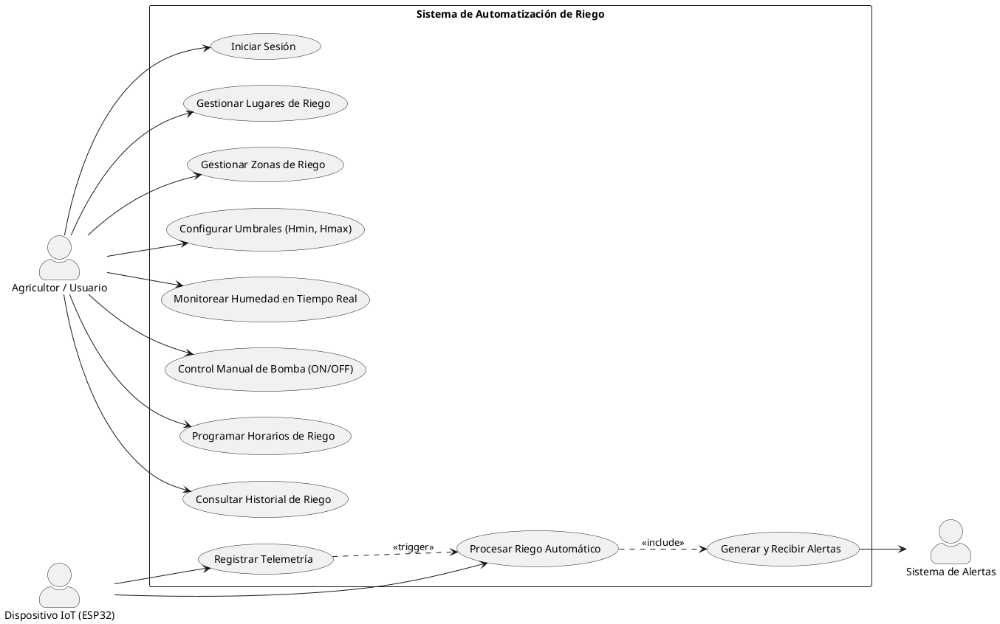
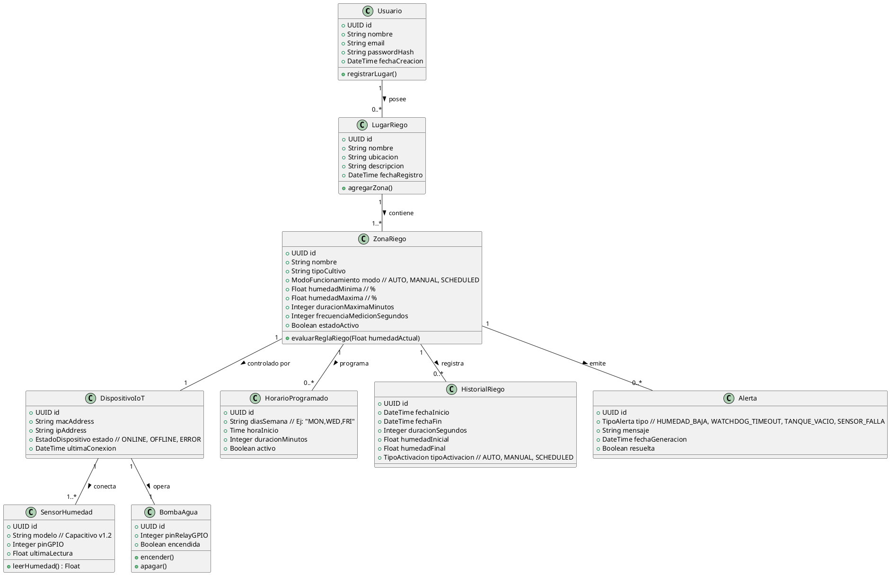
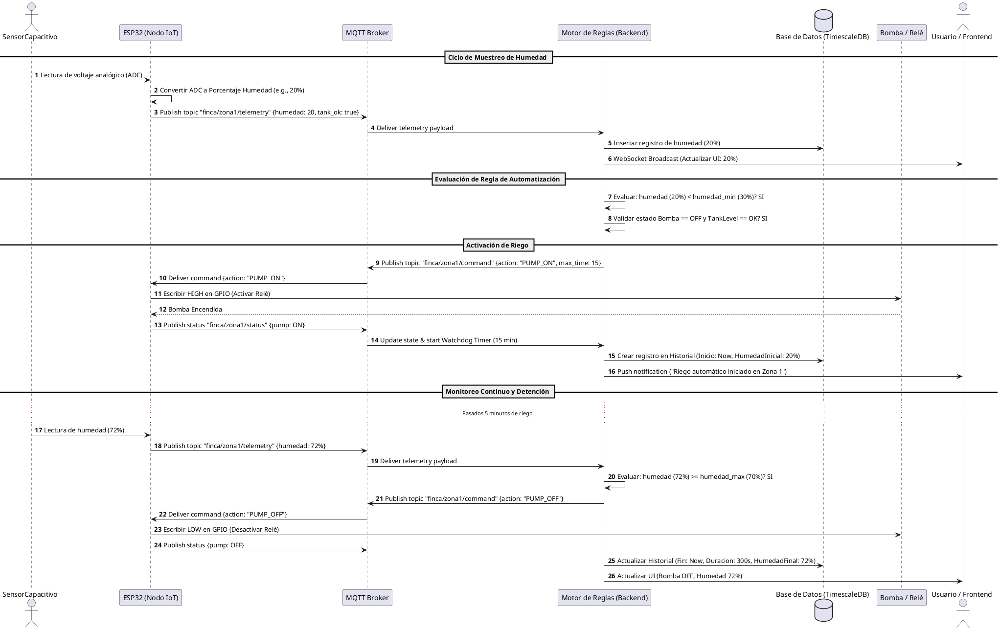
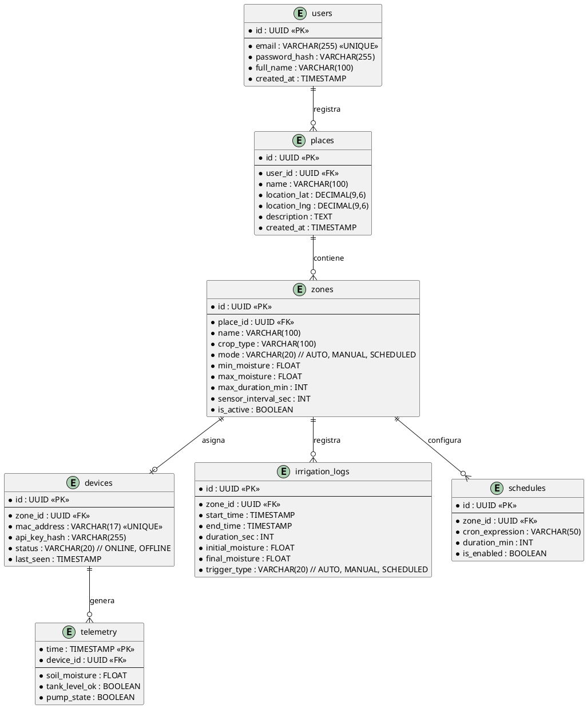

# PROPUESTA TÉCNICA Y ARQUITECTURA DE SISTEMA
## Sistema de Automatización de Riego Agrícola Basado en IoT

---

## 1. DESCRIPCIÓN GENERAL DEL SISTEMA

El **Sistema de Automatización de Riego IoT Agrícola** es una plataforma integral de hardware y software diseñada para optimizar el consumo de agua, incrementar el rendimiento de los cultivos y automatizar los procesos de irrigación en entornos agrícolas e invernaderos.

El sistema se basa en una arquitectura distribuida y escalable compuesta por nodos sensor/actuador impulsados por microcontroladores **ESP32**, un broker de mensajería ligero **MQTT**, un backend centralizado que implementa motores de reglas con control por **histéresis y perro guardián (watchdog)**, y un dashboard web/móvil intuitivo.

### Características Clave:
* **Multi-Lugar y Multi-Zona**: Permite a un agricultor gestionar múltiples fincas, invernaderos o parcelas, subdivididos en zonas de riego independientes.
* **Control Inteligente de Humedad**: Mide constantemente la humedad capacitiva del suelo y activa el riego en función de umbrales personalizables ($H_{\text{mín}}$ y $H_{\text{máx}}$).
* **Modos de Operación Tripartitos**: Automático (basado en sensores), Programado (basado en cronogramas y horarios) y Manual (anulación por el usuario).
* **Mecanismos de Seguridad y Resiliencia**: Protección contra marcha en seco de la bomba, tiempo máximo de riego desbocado (watchdog), y modo autosuficiente offline en el microcontrolador ante fallas de red.

---

## 2. REQUISITOS FUNCIONALES

| ID | Categoría | Descripción del Requisito Funcional |
| :--- | :--- | :--- |
| **RF-01** | Autenticación | El sistema debe permitir el registro, inicio de sesión y gestión de perfiles de usuario seguros. |
| **RF-02** | Lugares | El usuario puede registrar, listar, editar y eliminar Lugares de Riego (fincas, campos, invernaderos). |
| **RF-03** | Zonas | El usuario puede crear múltiples Zonas de Riego asociadas a un Lugar específico, asignando el tipo de cultivo o planta. |
| **RF-04** | Sensores | El sistema permite vincular uno o varios sensores de humedad de suelo capacitivos a cada Zona de Riego. |
| **RF-05** | Actuadores | El sistema permite asignar y controlar bombas de agua o electroválvulas asociadas a cada Zona. |
| **RF-06** | Riego Auto | Si la humedad medida es $< H_{\text{mín}}$, el sistema activa automáticamente la bomba de la zona correspondiente. |
| **RF-07** | Riego Auto Stop | Si la humedad medida alcanza $\ge H_{\text{máx}}$, el sistema apaga automáticamente la bomba. |
| **RF-08** | Control Manual | El usuario puede encender o apagar manualmente la bomba en cualquier momento desde el dashboard. |
| **RF-09** | Modo Programado | El usuario puede definir horarios de riego específicos (días, horas de inicio y duración). |
| **RF-10** | Umbrales | El usuario debe poder modificar $H_{\text{mín}}$, $H_{\text{máx}}$, duración máxima del riego y frecuencia de muestreo por zona. |
| **RF-11** | Monitoreo Realtime | El dashboard debe visualizar en tiempo real: % humedad, estado de la bomba (ON/OFF), salud del sensor y nivel del tanque de agua. |
| **RF-12** | Historial | El sistema debe guardar un registro inmutable de cada evento de riego (inicio, fin, duración, humedad previa/posterior, origen del riego). |
| **RF-13** | Alertas | El sistema debe emitir alertas por sobrepaso de tiempo de riego, fallas de comunicación con el sensor, o nivel crítico de tanque. |
| **RF-14** | Perro Guardián | Desactivación forzada de la bomba si el tiempo encendido excede el valor `max_duration_minutes`. |
| **RF-15** | Anti-Rebote | Incorporar un tiempo de espera mínimo (*cooldown*) entre apagado y reencendido para evitar desgaste mecánico del relé/bomba. |

---

## 3. REQUISITOS NO FUNCIONALES

| ID | Categoría | Descripción del Requisito No Funcional |
| :--- | :--- | :--- |
| **RNF-01** | **Escalabilidad** | La arquitectura backend y el broker MQTT deben soportar al menos 10,000 nodos IoT concurrentes enviando telemetría cada 10 segundos. |
| **RNF-02** | **Disponibilidad** | El servicio backend debe ofrecer un tiempo de actividad (*uptime*) mínimo del 99.9%. |
| **RNF-03** | **Tiempo de Respuesta** | La latencia de transmisión de comandos manuales desde el frontend hacia el actuador IoT debe ser $< 500 \text{ ms}$. |
| **RNF-04** | **Tolerancia a Fallos** | Si la conexión a internet cae, el microcontrolador ESP32 debe continuar ejecutando la regla de riego automático localmente. |
| **RNF-05** | **Seguridad en Red** | Toda la comunicación entre los dispositivos ESP32 y el servidor debe cifrarse mediante **TLS 1.3** (MQTTS/HTTPS) con autenticación por Token JWT / certificados x509. |
| **RNF-06** | **Usabilidad** | Interfaz web adaptativa (*Responsive UI*) optimizada para móviles y escritorios, con gráficos intuitivos. |
| **RNF-07** | **Persistencia Eficiente** | Uso de base de datos relacional y de series de tiempo para telemetría masiva sin ralentizar las consultas analíticas. |
| **RNF-08** | **Mantenibilidad** | Arquitectura modular basada en microservicios o monolito modular (API REST clean architecture). |

---

## 4. ACTORES DEL SISTEMA

1. **Usuario / Agricultor / Administrador**:
   - Persona encargada de gestionar los lugares de riego, configurar zonas, ajustar umbrales, revisar métricas e historial, e intervenir manualmente.
2. **Dispositivo IoT (ESP32 Gateway / Node)**:
   - Nodo de hardware físico equipado con sensores de humedad de suelo, sensor de nivel de agua y módulo de relés para la bomba. Envía telemetría y ejecuta comandos.
3. **Servidor Backend / Motor de Reglas**:
   - Sistema central que procesa la telemetría, aplica las reglas de automatización, registra en la base de datos y dispara alertas push/email.
4. **Sistema de Notificaciones Externa**:
   - Servicio encargado de enviar alertas por correo electrónico, SMS o WebPush al usuario en caso de fallos o anomalias.

---

## 5. CASOS DE USO PRINCIPALES

* **UC-01: Registrar Lugar y Zona de Riego**
  - *Precondición*: Usuario autenticado.
  - *Flujo Principal*: El usuario crea un nuevo "Lugar" (ej. "Finca El Paraíso") y dentro crea una "Zona" (ej. "Zona 1 - Tomates"), especificando tipo de cultivo y ubicación.

* **UC-02: Configurar Parámetros de Riego**
  - *Flujo Principal*: El usuario selecciona la Zona 1 e ingresa $H_{\text{mín}} = 30\%$, $H_{\text{máx}} = 70\%$, $T_{\text{máx}} = 15 \text{ min}$, y frecuencia de lectura = $30 \text{ s}$.

* **UC-03: Procesar Muestreo y Ejecutar Riego Automático**
  - *Precondición*: Modo en "AUTOMÁTICO".
  - *Flujo Principal*: 
    1. ESP32 lee sensor de humedad ($20\%$).
    2. ESP32 publica lectura por MQTT `/telemetry`.
    3. Motor de reglas evalúa $20\% < 30\%$.
    4. Servidor (o ESP32 en modo local) envía comando `PUMP_ON`.
    5. Bomba se enciende y se registra inicio de evento.
    6. Muestreo continuo muestra subida de humedad ($25\% \to 40\% \to 72\%$).
    7. Al llegar a $72\% \ge 70\%$, se envía comando `PUMP_OFF`.
    8. Evento registrado en historial con duración y delta de humedad.

* **UC-04: Control Manual del Riego**
  - *Flujo Principal*: Usuario presiona botón "Encender Riego" en la app. El sistema envía señal de activación inmediata ignorando el valor del sensor.

---

## 6. DIAGRAMA DE CASOS DE USO (PlantUML)



---

## 7. DIAGRAMA DE CLASES DEL DOMINIO (PlantUML)



---

## 8. DIAGRAMA DE SECUENCIA: RIEGO AUTOMÁTICO (PlantUML)



---

## 9. ARQUITECTURA GENERAL DEL SISTEMA

El sistema sigue el patrón de **Arquitectura IoT en 4 Capas**:

```
+-----------------------------------------------------------------------+
|                       CAPA DE PRESENTACIÓN (UI)                       |
|   Dashboard Web (React / HTML5) | App Móvil (PWA) | Notificaciones    |
+-----------------------------------+-----------------------------------+
                                    | REST API / WebSockets (HTTPS/WSS)
+-----------------------------------v-----------------------------------+
|                  CAPA DE APLICACIÓN Y MOTOR DE REGLAS                 |
|   API Gateway | Rule Engine (Hysteresis & Watchdog) | Scheduled Worker |
+-----------------------------------+-----------------------------------+
                                    | Internal Bus / ORM
+-----------------------------------v-----------------------------------+
|                    CAPA DE DATOS Y PERSISTENCIA                       |
|   PostgreSQL (PostGIS - Metadata) | TimescaleDB (Telemetría / Logs)    |
+-----------------------------------+-----------------------------------+
                                    | MQTT Bridge (MQTTS - TLS 1.3)
+-----------------------------------v-----------------------------------+
|                   CAPA DE DISPOSITIVOS IoT (EDGE)                     |
|   ESP32 Gateway Node | Sensor Capacitivo v1.2 | Relé Optoacoplado     |
+-----------------------------------------------------------------------+
```

---

## 10. MODELO ENTIDAD-RELACIÓN (PlantUML ERD)



---

## 11. TABLAS DE LA BASE DE DATOS (ESQUEMA SQL DDL)

```sql
-- Extensión para UUIDs y Series de Tiempo
CREATE EXTENSION IF NOT EXISTS "uuid-ossp";

-- Tabla de Usuarios
CREATE TABLE users (
    id UUID PRIMARY KEY DEFAULT uuid_generate_v4(),
    email VARCHAR(255) UNIQUE NOT NULL,
    password_hash VARCHAR(255) NOT NULL,
    full_name VARCHAR(100) NOT NULL,
    created_at TIMESTAMP WITH TIME ZONE DEFAULT CURRENT_TIMESTAMP
);

-- Tabla de Lugares de Riego
CREATE TABLE places (
    id UUID PRIMARY KEY DEFAULT uuid_generate_v4(),
    user_id UUID NOT NULL REFERENCES users(id) ON DELETE CASCADE,
    name VARCHAR(100) NOT NULL,
    address_location TEXT,
    latitude DECIMAL(9,6),
    longitude DECIMAL(9,6),
    description TEXT,
    created_at TIMESTAMP WITH TIME ZONE DEFAULT CURRENT_TIMESTAMP
);

-- Tabla de Zonas de Riego
CREATE TABLE zones (
    id UUID PRIMARY KEY DEFAULT uuid_generate_v4(),
    place_id UUID NOT NULL REFERENCES places(id) ON DELETE CASCADE,
    name VARCHAR(100) NOT NULL,
    crop_type VARCHAR(100) NOT NULL,
    mode VARCHAR(20) NOT NULL DEFAULT 'AUTO' CHECK (mode IN ('AUTO', 'MANUAL', 'SCHEDULED')),
    min_moisture NUMERIC(5,2) NOT NULL DEFAULT 30.00,
    max_moisture NUMERIC(5,2) NOT NULL DEFAULT 70.00,
    max_duration_min INT NOT NULL DEFAULT 15,
    sensor_interval_sec INT NOT NULL DEFAULT 30,
    is_active BOOLEAN DEFAULT TRUE,
    created_at TIMESTAMP WITH TIME ZONE DEFAULT CURRENT_TIMESTAMP
);

-- Tabla de Dispositivos IoT
CREATE TABLE devices (
    id UUID PRIMARY KEY DEFAULT uuid_generate_v4(),
    zone_id UUID UNIQUE REFERENCES zones(id) ON DELETE SET NULL,
    mac_address VARCHAR(17) UNIQUE NOT NULL,
    firmware_version VARCHAR(20) DEFAULT '1.0.0',
    status VARCHAR(20) DEFAULT 'OFFLINE' CHECK (status IN ('ONLINE', 'OFFLINE', 'ERROR')),
    last_seen TIMESTAMP WITH TIME ZONE
);

-- Tabla de Telemetría (Optimizada para Series Temporales)
CREATE TABLE telemetry (
    time TIMESTAMP WITH TIME ZONE NOT NULL,
    device_id UUID NOT NULL REFERENCES devices(id) ON DELETE CASCADE,
    soil_moisture NUMERIC(5,2) NOT NULL,
    tank_level_ok BOOLEAN NOT NULL DEFAULT TRUE,
    pump_state BOOLEAN NOT NULL DEFAULT FALSE
);

-- Indexación acelerada para telemetría por dispositivo y tiempo
CREATE INDEX idx_telemetry_device_time ON telemetry (device_id, time DESC);

-- Tabla de Historial de Riego
CREATE TABLE irrigation_logs (
    id UUID PRIMARY KEY DEFAULT uuid_generate_v4(),
    zone_id UUID NOT NULL REFERENCES zones(id) ON DELETE CASCADE,
    start_time TIMESTAMP WITH TIME ZONE NOT NULL,
    end_time TIMESTAMP WITH TIME ZONE,
    duration_sec INT,
    initial_moisture NUMERIC(5,2),
    final_moisture NUMERIC(5,2),
    trigger_type VARCHAR(20) NOT NULL CHECK (trigger_type IN ('AUTO', 'MANUAL', 'SCHEDULED'))
);
```

---

## 12. DISEÑO DE LA API RESTful (ENDPOINTS)

### Autenticación
* `POST /api/v1/auth/login`: Iniciar sesión y obtener Bearer JWT.

### Lugares y Zonas
* `GET /api/v1/places`: Listar lugares del usuario.
* `POST /api/v1/places`: Crear un lugar de riego.
* `PUT /api/v1/places/{id}`: Editar información del lugar.
* `GET /api/v1/places/{id}/zones`: Listar zonas de un lugar.
* `POST /api/v1/zones`: Crear una zona de riego.
* `PUT /api/v1/zones/{id}/config`: Modificar parámetros ($H_{\text{mín}}$, $H_{\text{máx}}$, modo, tiempos).

### Control Manual y Monitoreo
* `GET /api/v1/zones/{id}/status`: Obtener estado actual (Humedad, bomba, sensor, tanque).
* `POST /api/v1/zones/{id}/pump`: Activar/Desactivar manualmente la bomba.
  - *Payload*: `{"action": "ON"}` o `{"action": "OFF"}`
* `GET /api/v1/zones/{id}/history`: Consultar historial de eventos de riego.

---

## 13. FLUJO COMPLETO DEL PROCESO AUTOMÁTICO

```
               +----------------------------------+
               |  ESP32 MIDE HUMEDAD DEL SUELO    |
               +----------------+-----------------+
                                |
                                v
               +----------------------------------+
               |   ¿HUMEDAD ACTUAL < H_MINIMA?    |
               +-------+------------------+-------+
                       |                  |
                    SI |                  | NO
                       v                  v
        +-----------------------+   +------------------------+
        |   ¿BOMBA ESTÁ OFF?    |   |  ¿HUMEDAD >= H_MAX?    |
        +---+---------------+---+   +-----------+------------+
            |               |                   |
         SI |            NO |                SI |
            v               v                   v
+-------------------+ +-----------+   +-------------------+
| ¿TANQUE DE AGUA OK| | CONTINUAR |   | APAGAR BOMBA      |
|     Y COOLDOWN?   | | MONITOREO |   | REGISTRAR HISTOR. |
+---+-----------+---+ +-----------+   +-------------------+
    |           |
 SI |        NO | (Tanque vacío)
    v           v
+-------+   +---------------------+
|ENCENDER   | LANZAR ALERTA CRÍT. |
|BOMBA  |   | "TANQUE SIN AGUA"   |
+-------+   +---------------------+
```

---

## 14. LÓGICA Y PSEUDOCÓDIGO DEL SISTEMA DE RIEGO

### Pseudocódigo Motor de Reglas (Backend / Cloud Service)

```python
def process_telemetry_event(device_id, current_moisture, tank_ok):
    zone = get_zone_by_device_id(device_id)
    
    # 1. Verificación de fallos de hardware
    if current_moisture < 0 or current_moisture > 100:
        trigger_alert(zone.id, "SENSOR_FAULT", "Lectura fuera de rango (0-100%)")
        return

    if not tank_ok:
        if zone.pump_is_running():
            stop_pump(zone.id)
        trigger_alert(zone.id, "TANK_EMPTY", "Nivel de agua insuficiente para riego")
        return

    # 2. Evaluación según el Modo de Funcionamiento
    if zone.mode == "AUTO":
        # Regla de encendido: Humedad por debajo del mínimo con histéresis
        if current_moisture < zone.min_moisture and not zone.pump_is_running():
            if zone.passed_cooldown_period():
                start_pump(zone.id, trigger_type="AUTO", max_timeout=zone.max_duration_min)
            
        # Regla de apagado: Humedad alcanzó o superó el máximo
        elif current_moisture >= zone.max_moisture and zone.pump_is_running():
            stop_pump(zone.id, trigger_type="AUTO")
            
    # 3. Perro Guardián (Safety Watchdog Timeout)
    if zone.pump_is_running():
        elapsed_minutes = (now() - zone.pump_start_time).total_minutes()
        if elapsed_minutes >= zone.max_duration_min:
            stop_pump(zone.id, trigger_type="WATCHDOG")
            trigger_alert(zone.id, "WATCHDOG_TIMEOUT", f"Riego detenido automáticamente por superar {zone.max_duration_min} minutos.")
```

### Firmware ESP32 C++ (Arduino Framework + FreeRTOS)

```cpp
#include <WiFi.h>
#include <PubSubClient.h>
#include <ArduinoJson.h>

#define PIN_SOIL_SENSOR 34
#define PIN_RELAY 26
#define PIN_WATER_LEVEL 25

// Configuración de calibración del sensor capacitivo
const int AIR_VALUE = 3200;   // Lectura ADC en seco
const int WATER_VALUE = 1300; // Lectura ADC en agua

float readMoisturePercentage() {
  int rawValue = analogRead(PIN_SOIL_SENSOR);
  float percentage = map(rawValue, AIR_VALUE, WATER_VALUE, 0, 100);
  if (percentage < 0) percentage = 0;
  if (percentage > 100) percentage = 100;
  return percentage;
}

void setup() {
  pinMode(PIN_RELAY, OUTPUT);
  digitalWrite(PIN_RELAY, LOW); // Relé normalmente abierto (OFF)
  pinMode(PIN_WATER_LEVEL, INPUT_PULLUP);
  Serial.begin(115200);
}

void loop() {
  float moisture = readMoisturePercentage();
  bool tankOk = digitalRead(PIN_WATER_LEVEL) == HIGH;
  
  // Publicar telemetría JSON vía MQTT
  StaticJsonDocument<200> doc;
  doc["moisture"] = moisture;
  doc["tank_ok"] = tankOk;
  
  char buffer[256];
  serializeJson(doc, buffer);
  // mqttClient.publish("finca/zona1/telemetry", buffer);
  
  delay(30000); // Frecuencia de muestreo (30s)
}
```

---

## 15. PROPUESTA DE COMPONENTES IoT (BILL OF MATERIALS)

| Componente | Modelo Recomendado | Cantidad x Zona | Función |
| :--- | :--- | :--- | :--- |
| **Microcontrolador** | ESP32 WROOM-32D | 1 | Procesamiento local, conectividad Wi-Fi/Bluetooth, control GPIO. |
| **Sensor de Humedad** | Sensor Capacitivo v1.2 | 1 - 2 | Medición de humedad por variación capacitiva (resistente a corrosión). |
| **Módulo Relé** | Relé 5V Optoacoplado 10A | 1 | Aislamiento galvánico para conmutación de la bomba de 110V/220V o 12V. |
| **Bomba de Agua** | Bomba Sumergible 12V DC o Electroválvula Solenoide | 1 | Impulsión de agua al sistema de riego por goteo/aspersión. |
| **Sensor Nivel Agua** | Interruptor de Flotador / Ultrasonido JSN-SR04T | 1 | Protección contra marcha en seco del depósito. |
| **Fuente de Poder** | Fuente Conmutada 12V 3A + Regulator Step-Down LM2596 (5V) | 1 | Alimentación eléctrica del microcontrolador y la bomba. |
| **Gabinete** | Gabinete Plástico Estanco IP67 | 1 | Protección del circuito contra humedad, lluvia y polvo en campo. |

---

## 16. RECOMENDACIONES DE SEGURIDAD Y MANTENIMIENTO

1. **Protección Hardware contra Fallas (Fail-Safe)**:
   - Utilizar relés con configuración **Normalmente Abierto (NO)** para que en caso de corte de energía en el ESP32, la bomba permanezca apagada por defecto.
   - Conectar un interruptor electromecánico de flotador en serie con la alimentación de la bomba para impedir mecánicamente el encendido si el tanque está vacío.

2. **Ciberseguridad**:
   - Autenticación **mTLS** (Certificados X.509 por dispositivo ESP32) para conexión a MQTT Broker.
   - Encriptación **TLS 1.3** en todas las peticiones HTTPS REST API.
   - Implementación de **Rate Limiting** para prevenir ataques DoS en los endpoints de accionamiento manual.

3. **Mantenimiento Preventivo del Sensor**:
   - Aunque el sensor capacitivo es superior a los sensores resistivos en durabilidad, se recomienda calibrar los valores `AIR_VALUE` y `WATER_VALUE` cada 6 meses debido al asentamiento de sales minerales en el suelo.

---

## 17. EJEMPLO PRÁCTICO DE FUNCIONAMIENTO

### Escenario: "Invernadero A - Zona 1: Tomates Cherry"
- **Configuración de Zona**:
  - $H_{\text{mín}} = 35\%$
  - $H_{\text{máx}} = 65\%$
  - $T_{\text{máx\_riego}} = 10 \text{ minutos}$
  - Muestreo = $15 \text{ segundos}$

- **Línea de Tiempo del Evento**:
  1. **14:00:00** - Telemetría: Humedad = $38\%$ (Estado: BOMBA OFF).
  2. **14:30:00** - Telemetría: Humedad = $33\%$ ($33\% < 35\%$).
  3. **14:30:02** - Motor de reglas activa **PUMP_ON**.
  4. **14:30:03** - Relé se cierra. Bomba de 12V inicia flujo de riego por goteo.
  5. **14:35:00** - Telemetría en tiempo real: Humedad sube a $52\%$. Bomba continúa ON.
  6. **14:38:15** - Telemetría: Humedad alcanza $66\%$ ($66\% \ge 65\%$).
  7. **14:38:16** - Motor de reglas envía comando **PUMP_OFF**. Bomba se apaga.
  8. **14:38:17** - Se guarda registro en `irrigation_logs`: Duración: $494 \text{ s}$ (8.2 min), Delta Humedad: $+33\%$.

---

## 18. TECNOLOGÍAS RECOMENDADAS

* **Frontend**: HTML5, Vanilla CSS3 (Custom Design System con modo oscuro), Javascript ES6+ (o React + Vite para SPA interactiva).
* **Backend**: Node.js (Express / TypeScript) o Python (FastAPI / Celery para tareas programadas).
* **Broker MQTT**: EMQX / Eclipse Mosquitto con soporte TLS.
* **Base de Datos**: PostgreSQL 15 + TimescaleDB (para telemetría masiva en series de tiempo).
* **IoT / Edge**: ESP32 C++ (ESP-IDF o Arduino Core con FreeRTOS).
